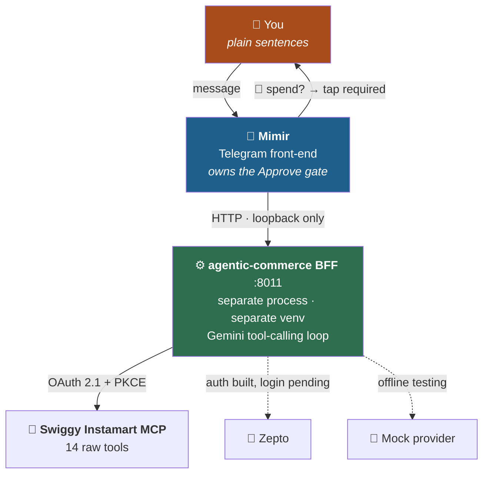

<div align="center">

# 🛒 MIMIR

**A shopping assistant you talk to on Telegram.**
It searches real stores, builds your basket, and places the order —
but only after you tap to approve the exact total.


[Try the flow](#-what-it-feels-like) · [How it works](#-how-it-works) · [The money path](#-the-money-path) · [Setup](#-setup) · [Developer mode](#-developer-surface--bot_modefull)

</div>

---

## What this is

Most shopping bots hand you links. Mimir **acts**: it drives the store's own
agent interface with your login, so it sees your real addresses, your real cart
and your real order history — and everything it does shows up in your normal
Swiggy app.

Which is exactly why the approval step exists.

> **🔒 Nothing is ever charged without a tap.**
> Before any order, Mimir shows the items, every fee, and the final number, then
> waits. No tap, no order. Every time.

---

## 💬 What it feels like

<table>
<tr><td width="50%" valign="top">

**You**
> bourbon biscuits

**Mimir**
> 🔍 **bourbon biscuits**
>
> ₹21.00 — Britannia The Original Bourbon (120 g)
> ₹15.00 — Sunfeast Bourbon Dark Fantasy (99 g)
> ₹80.00 — Lotus Biscoff Caramelized (150 g)
>
> 💰 Cheapest in stock: ₹15.00

**You**
> 3 of the Britannia

</td><td width="50%" valign="top">

**Mimir**
> ⚠️ **Only 1 available** (you asked for 3)
>
> 🛒 **Your cart**
> 1× Britannia The Original Bourbon — ₹21.00
> ―――――――――――――
> Item Total ₹21.00
> Handling Fee ₹6.01
> Small Cart Fee ₹20.00
> Delivery Partner Fee ₹30.00
> GST and Charges ₹9.00
> **To pay ₹86.00**

**You**
> checkout

**Mimir** · `[ ✅ Place order ]` `[ ✖ Cancel ]`

</td></tr>
</table>

Two details there matter more than they look. Mimir told you an item was capped
at one **before** you paid, and it showed you that ₹21 of biscuits costs ₹86 —
because ₹65 of it is fees. Both facts were in the store's data all along, and
both are easy to throw away.

---

## 🧠 How it works



**Why the conversation runs on the commerce side.** The `ProviderAdapter`
interface exposes what is *comparable across providers* — search, cart,
checkout. Swiggy's MCP server actually exposes **14 tools**, including
`your_go_to_items`, `get_orders`, `track_order` and `get_payment_options`. A
client driving only the canonical wrappers loses most of what the provider can
do: it cannot offer you a list of biscuits to choose from, or read your usual
items. So plain messages go to the commerce agent, which holds the real tool set.

Mimir keeps the one decision that loop must not make alone: **whether to spend.**

The sidecar is a separate process on purpose. Its `requirements.txt` pins `mcp`
exactly, because an unpinned bump silently broke its transport once. Keeping
those pins out of Mimir's environment means a provider-SDK problem cannot take
the bot down with it.

<details>
<summary><b>Two LLM layers, and why</b></summary>

<br>

| Layer | Model | Job |
|---|---|---|
| Mimir's own loop | Groq `openai/gpt-oss-120b` → Gemini `gemini-flash-latest` → local Ollama | Failover on rate limits or outages |
| Commerce loop | `gemini-3.5-flash-lite` | Holds the store's full 14-tool set |

Neither model name is pinned to a dated build. `llama-3.3-70b-versatile` was
retired from Groq and started 404-ing, silently killing the primary provider;
`gemini-2.0-flash` did the same to the fallback. **A hardcoded model name is a
time bomb on a hosted API.**

Tool results are stripped of HTML before entering the prompt — rendering and
reasoning want different strings from the same function.

</details>

---

## 🏪 Stores

| Store | Status | Notes |
|---|---|---|
| 🛒 **Swiggy Instamart** | ✅ Wired | `mcp.swiggy.com/im` — groceries. Verified against a live account (14 tools) |
| 🍛 **Swiggy Food** | ✅ Wired | `mcp.swiggy.com/food` — restaurants, menus, ordering. Verified live (18 tools) |
| 🍽 **Swiggy Dineout** | ⚙️ Tools verified | `mcp.swiggy.com/dineout` — 12 tools confirmed; response shapes need a real booking |
| **Zepto** | ⛔ Blocked upstream | Flow verified correct; their `/register` returns Redis OOM — a Zepto-side outage |
| **Mock provider** | 🧪 Offline | In-memory store for testing without spending |

Swiggy runs [three MCP servers](https://github.com/Swiggy/swiggy-mcp-server-manifest)
behind **one** OAuth identity, so the token you already have opens all three.
Each is registered separately, because each names its money tool differently —
`checkout`, `place_food_order`, `book_table` — and a shared guard would simply
never match two of them.

> **Every Food tool is address-scoped.** `search_restaurants`, `search_menu`,
> `get_restaurant_menu`, `get_food_cart`, `update_food_cart` and
> `place_food_order` all reject calls without an `addressId` — which Swiggy's
> published reference does not mark required, but the live schema does. The
> adapter resolves one from `get_addresses` and injects it, including into the
> agent loop's raw calls.
>
> Use `python -m scripts.discover_swiggy <food|dineout|im>` after logging in: it
> diffs the live tool surface against the manifest and flags any unguarded money
> tool. The docs and the servers disagree often enough to be worth re-running —
> Instamart's docs listed 16 tools against 14 live, Food's listed 17 against 18.

Price comparison switches on with the second real store. With one store there is
nothing to compare, so it is deliberately off.

> ⚠️ Swiggy's manifest states that **third-party app development is not
> permitted at this time**, and Zomato's says the same. Personal single-account
> use is what these are open for today; anything multi-tenant needs to go
> through them first.

---

## ⌨️ Commands

Mimir runs as a shopping assistant by default (`BOT_MODE=shopping`). Only these
are registered and only these appear in the Telegram menu — anything else is
answered with *unknown command*, because **a menu that hides a command still
live when typed is a menu that lies about what the bot can do.**

| Command | Description | Approval |
|---------|-------------|----------|
| `/shop <request>` | Order things in plain English | Checkout only |
| `/search <item>` | Search the connected store | Auto |
| `/cart` | Show the cart and total | Auto |
| `/service [name]` | Groceries · food · a table | Auto |
| `/autopay [amt\|off]` | Auto-approve orders under a limit | Auto |
| `/pay [cash\|upi]` | How orders get paid for | Auto |
| `/providers` | List providers + connection state | Auto |
| `/connect <id>` | Log in to a store (`swiggy`, `zepto`) | Auto |
| `/start` · `/help` | Onboarding and command list | Auto |
| `/status` | Am I working? | Auto |
| `/persona <name>` | `mimir` · `formal` · `friendly` · `brief` | Auto |
| `/stop` | Shut the bot down | Auto |

**You rarely need any of them.** Plain messages go straight to the commerce
agent — *"do we have milk?"*, *"add 2 packs of bourbon biscuits"*, *"what did I
order last week?"*, *"I'm making samosas, what do I need?"*

### 🥣 Pick what you're shopping for

On your first message Mimir asks once, then remembers:

```
👋 First things first — what are we doing?

   🛒  Instamart — Groceries in minutes
   🍛  Food — Restaurant delivery
   🍽  Dineout — Book a table
```

Change it any time with `/service`, or `/service food` if you already know.
Results are labelled per service — a restaurant is not "in stock" and a table is
not a product.

### ⚡ Auto-approve small orders

Off by default. `/autopay` lets you skip the tap for small orders:

```
⚡ Auto-approve: on
  • Up to ₹500 per order
  • ₹1,100 of today's ₹1,500 left
  • Anything larger still needs your tap
```

Three ceilings, and you can only move the middle one:

| Bound | Set by | Why |
|---|---|---|
| `COMMERCE_AUTOPAY_ENABLED` | operator, in `.env` | While false, no chat can enable it at all — a saved preference can't outlive the operator's decision |
| Per-order limit | you, clamped to `COMMERCE_AUTOPAY_MAX_RUPEES` | The obvious one |
| Rolling daily total | operator, `COMMERCE_AUTOPAY_DAILY_RUPEES` | A per-order limit alone bounds nothing — an agent looping on checkout places *many small* orders, not one big one |

An order whose total can't be read is **never** auto-approved: `None` means "we
couldn't parse the price", not "it's free". You still get the full itemised bill
for every auto-approved order, because an order that appears with no record of
what was in it is indistinguishable from a bug.

**Bookings are never auto-approved.** A free reservation measures ₹0 against
every rupee ceiling, so it would be waved through without limit — and Swiggy's
docs say a booking cannot be cancelled through the MCP. It always asks.

### 💳 How payment actually works

`/pay` picks between the two methods Swiggy's MCP offers. There are only two,
and only one of them is hands-free:

| Method | At pay time | Truly automatic? |
|---|---|---|
| 💵 **Cash on delivery** | nothing to authorise | ✅ yes |
| 📱 **UPI app** | you approve with your UPI PIN | ❌ every order |
| 🖥 **Scan QR** (desktop) | same PIN step | ❌ every order |

> **There is no card and no wallet.** `get_payment_options` returns UPI apps,
> scan-QR and cash — its docs state that even *"UPI Collect and saved VPAs are
> not surfaced"*. `checkout` accepts `paymentMethod` of only `"UPI"` or
> `"Cash"`. A card saved in your Swiggy account is not reachable from the MCP at
> all.
>
> And UPI could not be automated even if it were offered: Swiggy returns a
> `upiIntentUrl` for **you** to complete while the agent only polls
> `check_payment_status`, and [RBI's Authentication Mechanisms Directions,
> 2025](https://www.rbi.org.in) require two factors — at least one dynamic — on
> every domestic digital payment from 1 April 2026. A server holding a token is
> neither.
>
> **So: cash on delivery + auto-approve is the only fully hands-free
> combination.** It is also the one where you still owe money at the door.

### 🎙️ Voice notes

Send a voice message instead of typing. Mimir transcribes it with
[Sarvam](https://sarvam.ai) — built for Indian languages and accents, so Hindi,
Kannada and Indian-accented English all work — echoes back what it heard, then
treats it exactly as if you had typed it.

```
You:    🎙️ 0:04
Mimir:  🎙️ Heard: "do we have milk and bread"  en-IN
        🔍 Searching…
```

Set `SARVAM_API_KEY` in `.env` to enable. Leave it blank and voice notes are
politely declined rather than ignored.

| | |
|---|---|
| Format | Telegram sends OGG/Opus, which Sarvam accepts directly — no ffmpeg, no re-encoding |
| Length | Up to 30 s (Sarvam's sync limit). Longer is refused *before* the upload, using the duration Telegram provides |
| Languages | Auto-detected across 22 Indian languages |
| Model | `saaras:v3`, overridable via `SARVAM_MODEL` |

**The transcript is echoed back on purpose.** Speech recognition is confident
even when it is wrong, and a misheard word here is a wrong item in a real cart.

**A spoken "yes" authorises nothing.** Voice is a faster keyboard: the transcript
re-enters through the same path a typed message uses, and the money gate still
waits for a tap on an inline button. Approval arrives as a Telegram
`callback_query` — a different update type that no model and no transcriber can
produce — which is exactly why a sentence cannot stand in for the tap.

---

## 💸 The money path

Checkout is the one commerce operation that requires your tap. Cart edits do
not — gating every "add milk" would make ordering unusable, so the friction sits
exactly where money moves.

Approving a bare "checkout" would tell you nothing about what you are buying, so
the prompt is built from a real cart snapshot:

```
🔒 PERMISSION REQUIRED

Action: place order on swiggy for ₹136.00
Details:
  2 × Toned Milk           @ ₹33.00
  1 × Whole Wheat Bread    @ ₹45.00
  Total: ₹136.00

        [ ✅ Approve ]   [ ✖ Deny ]
```

Five independent layers stand between the model and your money:

| # | Layer | What it stops |
|---|-------|---------------|
| 1 | `COMMERCE_ALLOW_LIVE` **+** the BFF's `DRY_RUN` | Two switches in two repos must agree before anything is real |
| 2 | `GATED_TOOLS` + `Guard` | No order without a tap on your phone |
| 3 | **Cart-bound confirmation token** | Single-use, expires in 300 s, void if the cart changes after you approve |
| 4 | `COMMERCE_MAX_ORDER_RUPEES` (₹5,000) | Mimir's own ceiling, checked *before* you are even prompted |
| 5 | `GuardedSwiggySession` | In-transport block; the last line even if a caller is confused |

> **Layer 3 is the subtle one.** A plain "checkout is armed" boolean authorises
> *whatever the cart contains when the call lands* — so an agent that added an
> item between you reading the total and tapping Approve would spend against an
> approval you never gave. Binding the token to a fingerprint of the exact cart
> you were shown closes that window: if the basket moves, the token is dead and
> you are asked again with the new number.

Layer 4 is Mimir's own limit, not the provider's — Swiggy explicitly declares
*no* cart-value ceiling (`max_order_value=None`), so relying on one would be
relying on nothing.

<details>
<summary><b>Paying: UPI, QR, or cash</b></summary>

<br>

Mimir asks which; it never picks for you. Google Pay · PhonePe · Paytm · BHIM ·
CRED · scan-me QR · cash on delivery.

Checkout follows the provider's documented sequence: `get_cart` →
`get_payment_options` → *you choose* → `checkout` with `paymentMethod` +
`intentApp`, or `generateUPIQR` for a desktop QR. Payment resolves
asynchronously — the order is created `PENDING_PAYMENT`, you authorise in your
UPI app, and the result is polled to a terminal state.

Money-path tool names are declared **per provider**, never shared. A global list
of one store's names silently fails to match another's — the guard never fires
and nothing raises. A gate that fails open is worse than no gate, because
everything upstream is written believing it holds.

</details>

> ⚠️ **Start with `DRY_RUN=true`** in agentic-commerce's `.env` and leave
> `COMMERCE_ALLOW_LIVE=false` in Mimir's until you have watched the whole flow
> against the mock provider.

---

## 🚀 Setup

### Prerequisites

<details open>
<summary><b>macOS</b></summary>

- macOS 12+ (Apple Silicon or Intel)
- Python 3.10+ (`brew install python`)
- [Ollama](https://ollama.com) — optional, the cloud cascade works without it

</details>

<details>
<summary><b>Windows (WSL2)</b></summary>

- Windows 10/11 with WSL2 (Ubuntu)
- Python 3.10+ in WSL
- [Ollama](https://ollama.com) installed on Windows

</details>

**Both** — a Telegram bot token from [@BotFather](https://t.me/BotFather), and
your chat ID from [@userinfobot](https://t.me/userinfobot).

### Quick start

```bash
git clone https://github.com/rupeshbharambe24/mimir-telegram-agent.git
cd mimir-telegram-agent

cp .env.example .env          # add your tokens and API keys

# WSL2 only — make Ollama on the Windows host reachable from the VM.
# Run in Windows PowerShell, then restart Ollama:
#   [System.Environment]::SetEnvironmentVariable("OLLAMA_HOST", "0.0.0.0", "User")
# On macOS this step does not exist: Ollama is on localhost already.

bash setup.sh                 # venv, deps, connection tests, service file

source ~/.venvs/ai-agent/bin/activate
python3 main.py
```

Then start the commerce sidecar and connect a store:

```bash
bash start-commerce.sh        # creates its own venv on first run
```

```
/connect swiggy               # opens Swiggy's login — phone + OTP, handled by Swiggy
/providers                    # confirm it took
```

The sidecar is vendored at `agentic-commerce/`. Set `COMMERCE_DIR` only if you
keep it elsewhere. Its `.env` and OAuth tokens are **not** in git — copy
`agentic-commerce/.env.example` and fill in `GEMINI_API_KEY` on a fresh clone.

### Free API keys

| Provider | Model | Free tier | Link |
|----------|-------|-----------|------|
| **Groq** | `gpt-oss-120b` | 14K req/day | [console.groq.com](https://console.groq.com) |
| **Sarvam** *(optional)* | `saaras:v3` STT | Free credit on signup | [sarvam.ai](https://sarvam.ai) |
| **Gemini** | Flash | 1500 req/day | [aistudio.google.com](https://aistudio.google.com/apikey) |
| **Ollama** | qwen, deepseek, … | Unlimited (local) | [ollama.com](https://ollama.com) |

<details>
<summary><b>Run as a service</b></summary>

<br>

**macOS** — `setup.sh` generates `com.mimir.agent.plist` with your paths filled in:

```bash
cp com.mimir.agent.plist ~/Library/LaunchAgents/
launchctl bootstrap gui/$(id -u) ~/Library/LaunchAgents/com.mimir.agent.plist

# and the commerce sidecar beside it
cp com.mimir.commerce.plist ~/Library/LaunchAgents/
launchctl bootstrap gui/$(id -u) ~/Library/LaunchAgents/com.mimir.commerce.plist
```

**WSL2** — `setup.sh` generates a systemd unit; `sudo systemctl enable --now ai-agent`.

Mimir starts on a cold WSL boot where the NAT interface often needs a few
seconds before it can carry traffic, so the Telegram client uses a 30 s connect
timeout rather than PTB's 5 s default — the first `getMe()` would otherwise time
out and kill the process.

</details>

---

## 🔧 Developer surface — `BOT_MODE=full`

Mimir began as a machine-control agent, and that whole surface is still in the
tree: files, shell, git, Jupyter, screenshots, process management, GPU, 37 extra
commands. It is **gated, not deleted**.

```bash
BOT_MODE=full   # in .env — restores all 47 commands, the menu entries, and the
                # developer tools in the model's tool set
```

One switch, `Config.SHOPPING_ONLY`, drives all three. Registration is gated
rather than the menu alone — hiding a command that still runs when typed makes
the menu a false statement about the bot.

<details>
<summary><b>The full command list (47)</b></summary>

<br>

| Group | Commands |
|---|---|
| **LLM** | `/ask` `/code` `/do` `/apply` |
| **Files** | `/read` `/ls` `/write` `/delete` `/send` `/find` `/tree` `/recent` |
| **Process** | `/run` `/watch` `/cmd` `/tail` `/procs` `/kill` `/history` |
| **Jupyter** | `/nb open` `/nb run` `/nb cell` `/nb edit` `/nb out` `/nb env` `/nb status` `/nb stop` |
| **Git** *(local only, never pushes)* | `/commit` `/diff` `/gitlog` `/undo` |
| **Host** | `/screenshot` `/models` `/logs` `/gpu` `/livestream` `/remote` |
| **Utility** | `/open` `/cd` `/pwd` `/clip` `/bookmark` `/go` `/remind` |

Read operations run immediately; writes (`/write`, `/delete`, `/run`, `/commit`)
send an inline keyboard and auto-deny after 5 minutes.

</details>

---

## 📁 Project structure

```
mimir-telegram-agent/
├── main.py                      # Entry point
├── config.py                    # Config from .env — incl. BOT_MODE / SHOPPING_ONLY
├── core/
│   ├── bot.py                   # Telegram handlers + the mode-gated menu
│   ├── agent.py                 # LLM tool-calling loop
│   ├── tools_registry.py        # Tool schemas + dispatch (mode-gated)
│   ├── llm_cascade.py           # Groq → Gemini → Ollama
│   ├── guard.py                 # Permission / approval system
│   ├── platform.py              # Host adapter — the ONLY OS-aware module
│   └── …                        # paths, session, brain, monitor, notebook
├── tools/
│   ├── commerce.py              # Client for the agentic-commerce BFF
│   ├── voice.py                 # Sarvam speech-to-text for voice notes
│   └── …                        # file_ops, process_ops, git_ops, screenshot, system_info
├── tests/                       # 157 tests
└── agentic-commerce/            # Vendored sidecar — separate process, separate venv
    ├── backend/
    │   ├── app.py               # FastAPI BFF, session + checkout token minting
    │   ├── agent/loop.py        # Gemini loop over the provider's raw MCP tools
    │   ├── providers/
    │   │   ├── oauth_pkce.py    # Shared OAuth 2.1 + PKCE + dynamic client reg
    │   │   ├── swiggy/          # One OAuth identity, three services:
    │   │   │   ├── manifest.py            #   /im       Instamart
    │   │   │   ├── manifest_food.py       #   /food     Food
    │   │   │   ├── manifest_dineout.py    #   /dineout  Dineout
    │   │   │   └── service_adapter.py     #   shared plumbing for the latter two
    │   │   └── zepto/           # Auth built; tool mapping pending first login
    │   └── canonical/           # Cross-provider types (comparison only)
    └── tests/                   # 23 tests
```

**Porting to another host**: everything OS-specific is behind
`core/platform.py` — screen capture, opening paths and URLs, clipboard, port
scanning, GPU reporting, and the prompt text describing the machine. Adding a
host means adding a branch there; no other module checks the platform.
`tests/conftest.py` exposes `wsl_only` / `mac_only` markers so host-specific
assertions skip cleanly instead of failing on the wrong machine.

---

## 🗺️ Roadmap

| | Status | |
|---|---|---|
| Conversational shopping | ✅ Live | Search, cart, usual items, order history, tracking |
| Swiggy Instamart | ✅ Live | Verified against a real account |
| Tap-to-approve ordering | ✅ Live | Itemised bill shown before every order |
| Payment method choice | ✅ Live | 6 UPI apps, QR, cash on delivery |
| Real orders | ⏸️ Held | Live spending off until deliberately enabled |
| Voice notes | ✅ Live | Sarvam `saaras:v3`, 22 Indian languages, 30 s |
| Swiggy Food | ✅ Live | Verified against a real account |
| Swiggy Dineout | ⚙️ Tools verified | Booking gated by an action-bound token; shapes unverified |
| Auto-approve | ✅ Live | Per-order + daily caps, off by default |
| Payment choice | ✅ Live | Cash or UPI — the only two Swiggy offers |
| **Zepto** | 🔸 Next | One login away from mapping its tools |
| **Price comparison** | 🔸 Next | Switches on with the second real store |
| **Multi-user** | 🔹 Design | Per-user store credentials, isolated and encrypted |

---

## 🔐 Security

- Store credentials and API keys stay on the local machine and are **never** sent to the language model or through Telegram.
- The commerce BFF binds `127.0.0.1` only.
- The bot answers exactly one `TELEGRAM_CHAT_ID`; everything else is logged and dropped.
- Git operations are local only and never push.

---

## 🤝 Contributing

Contributions welcome. Open items:

- **Verify Dineout response shapes** — needs one real booking against a live restaurant
- **Multi-user** — per-user OAuth tokens, encrypted at rest
- **More stores** — implement `ProviderAdapter`, add a manifest, register it
- **Docker** — containerised deployment
- **Linux native** — plain Linux desktop (`xdg-open`, `wl-copy`, `grim`)

```bash
git checkout -b feature/voice-notes
~/.venvs/ai-agent/bin/python -m pytest tests/ -q        # 157 tests
cd agentic-commerce && ./.venv/bin/python -m pytest -q  # 64 tests
```

## License

MIT — see [LICENSE](LICENSE).

---

<div align="center">
Built by <a href="https://github.com/rupeshbharambe24">@rupeshbharambe24</a>
</div>
